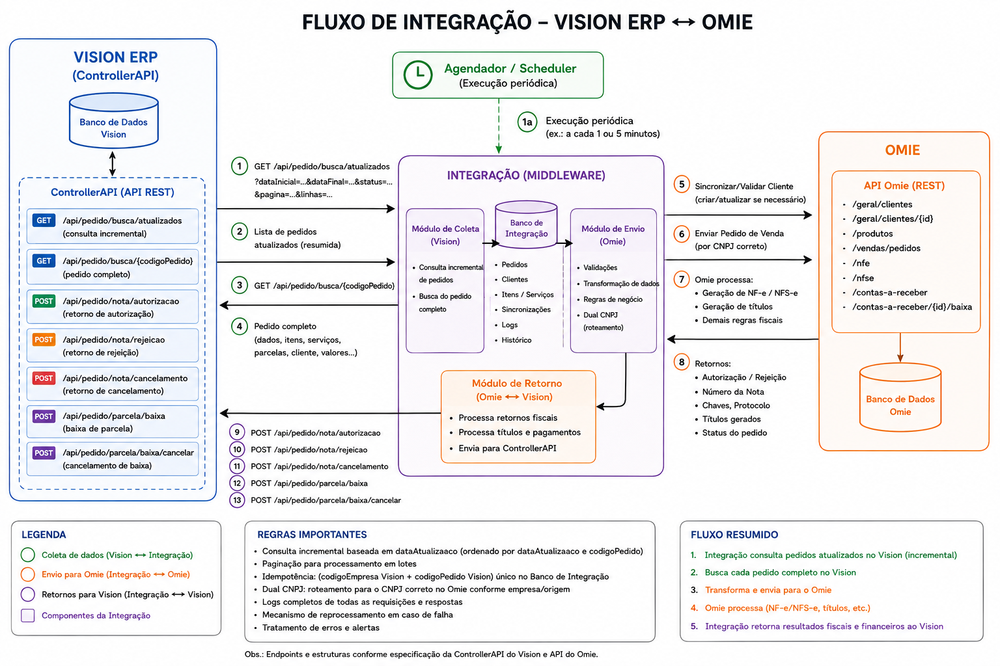

# Integração Vision ⇄ Omie

Middleware da Ecolife que leva os pedidos do **Vision ERP** para o **Omie ERP** — cliente, **pedido de
venda** (NF-e) e **ordem de serviço** (NFS-e) — na base Omie certa pelo CNPJ, e devolve ao Vision a
autorização, rejeição e cancelamento das notas, as baixas e os cancelamentos de baixa.



* **Rastreável:** cada pedido mostra em que etapa está, a causa de qualquer erro com dica de correção e
  todas as chamadas feitas ao Vision e ao Omie (request/response).
* **Reenvio manual:** de um pedido, dos selecionados ou de todos com a mesma causa.
* **Sem duplicidade:** códigos de integração determinísticos e consulta antes de incluir.
* **Mapeamento dinâmico:** regras de campo e tabelas de-para por conta, com listas carregadas do Omie
  (categorias, departamentos, projetos, contas correntes, produtos, serviços…).
* **Várias bases Omie:** cadastro de contas com CNPJ, App Key, App Secret (criptografado) e ativação.

Documentação: [Guia de implementação](docs/GUIA-IMPLEMENTACAO.md) ·
[API do Vision](docs/referencia-api-vision.md) · [API do Omie](docs/referencia-api-omie.md)

## Stack

Next.js 16 (App Router) · React 19 · TypeScript · Tailwind CSS 4 · componentes no padrão shadcn/ui sobre
Radix · TanStack Query e Table · Drizzle ORM (PostgreSQL ou PGlite) · croner · zod · Vitest.

Arquitetura limpa com DDD: o domínio e os casos de uso em `src/server` não dependem do Next.js e podem
ser levados para um backend NestJS sem reescrita (veja o guia, seção 3).

## Rodando localmente com os simuladores

Requer Node.js 20.9+.

```bash
npm install
npm run simulators          # Vision em :4010 e Omie em :4020 (deixe rodando)
```

Crie `.env.local`:

```bash
VISION_API_URL=http://127.0.0.1:4010/ControllerAPI
VISION_USERNAME=OMIE
VISION_PASSWORD=simulador
OMIE_API_URL=http://127.0.0.1:4020/api/v1
OMIE_READ_CACHE_MS=0
```

```bash
npm run dev                 # http://localhost:3000
npm run demo:seed           # cadastra 2 contas, regras e de-para e roda coleta + retorno
```

O banco sem `DATABASE_URL` é um PostgreSQL embarcado (PGlite) em `./.data/pglite`. Para apagar os dados
de teste, apague essa pasta.

Os simuladores respondem no mesmo formato da ControllerAPI real (PascalCase, envelope paginado, pedido
sem CNPJ da empresa) e trazem 8 pedidos: produtos, serviços, misto (PV + OS), produto sem de-para (erro
de mapeamento), empresa sem conta Omie (erro de roteamento), NF rejeitada, pedido com baixa de parcela e
uma cópia do caso real 14062 (serviço em KG cujo total não fecha e forma de pagamento "SEM FINANCEIRO").
O `demo:seed` associa as empresas 1 e 2 às contas na tabela *Empresa Vision → CNPJ*.

## Ambiente real

```bash
cp .env.example .env.local   # preencha; nunca versione este arquivo
```

| Variável | Para quê |
|---|---|
| `DATABASE_URL` | PostgreSQL 14+ (`docker compose up -d` sobe um local). Vazio = PGlite. |
| `APP_ENCRYPTION_KEY` | 32 bytes em base64 para criptografar os App Secrets. **Obrigatória em produção** e não pode mudar depois do cadastro das contas. |
| `APP_TIMEZONE` | Fuso das datas (padrão `America/Sao_Paulo`). |
| `VISION_API_URL`, `VISION_USERNAME`, `VISION_PASSWORD` | ControllerAPI do Vision. |
| `OMIE_API_URL` | Padrão `https://app.omie.com.br/api/v1`. |
| `OMIE_READ_CACHE_MS` | Cache de consultas idênticas ao Omie (padrão 55000). |
| `SYNC_INITIAL_LOOKBACK_DAYS` | Dias que a primeira coleta busca para trás (padrão 7). Valor inicial: depois de salvar Configurações vale o da tela, e "Recomeçar a coleta" aplica de novo. |
| `SCHEDULER_ENABLED` | Agendador interno (padrão `true`). |
| `OMIE_WEBHOOK_TOKEN` | Ativa `/api/webhooks/omie?token=…` (opcional). |
| `SLACK_WEBHOOK_URL` | Incoming Webhook do canal de alertas (segredo). Regras em Configurações › Alertas no Slack. |
| `APP_BASE_URL` | Endereço público da aplicação, para os links nos alertas. |
| `AUTH_USER_HEADER` | Cabeçalho com o usuário do proxy autenticado, gravado na auditoria (vazio = cabeçalhos comuns). |

```bash
npm run build && npm start
```

Primeiros passos na aplicação:

1. **Configurações** — teste a conexão com o Vision, confira a janela da primeira coleta (7 dias), defina
   as situações elegíveis, as **condições de pagamento** (por forma de pagamento do Vision e a padrão para
   pedidos sem parcelas) e as convenções do retorno (veja os pontos a validar no guia, seção 8).
2. **Contas Omie** — cadastre uma conta por base e use *Testar conexão* (confere o CNPJ da base).
3. **Mapeamentos** — em cada conta, associe o código da empresa do Vision na tabela *Empresa Vision →
   CNPJ* (o pedido do Vision não traz o CNPJ). Defina categoria e conta corrente (obrigatórias no Omie) e
   preencha os de-para de produtos e serviços (serviços pelo `codigoMaterial` do Vision). Use *Simular mapeamento* em um pedido antes de ligar a coleta.
4. **Painel / Pedidos** — acompanhe, corrija e reenvie.

## Scripts

| Comando | Faz |
|---|---|
| `npm run dev` / `build` / `start` | Next.js |
| `npm test` | Testes unitários, de rotas `/api` e ponta a ponta (simuladores + banco em memória) |
| `npm run test:coverage` | Os mesmos testes com cobertura (falha abaixo do piso em `vitest.config.mts`) |
| `npm run test:e2e` | Testes das telas com Playwright (rode `npm run build` antes) |
| `npm run typecheck` | Verificação de tipos |
| `npm run simulators` | Simuladores do Vision e do Omie |
| `npm run demo:seed` | Dados de demonstração na aplicação em execução (`APP_URL`, padrão `http://localhost:3000`) |
| `npm run db:generate` | Gera migração a partir de `schema.ts` |
| `npm run db:migrate` | Aplica as migrações (também aplicadas ao iniciar) |

## Estrutura

```
src/app/                  Telas e rotas /api (camada de apresentação)
src/components/           Componentes de interface
src/server/shared/        Kernel do domínio (Result, CNPJ, datas, portas)
src/server/modules/       Contextos: omie-accounts · mappings · integration · settings
src/server/infrastructure Vision, Omie, banco, agendador, HTTP
src/server/container.ts   Composition root
scripts/                  Simuladores, seed de demonstração, migração
tests/                    Testes ponta a ponta e das rotas /api
e2e/                      Testes das telas (Playwright)
.github/workflows/        CI: tipos, testes com cobertura, PostgreSQL real e telas
docs/                     Guia de implementação e referências das APIs
```

## Testes e CI

* **Vitest** (`npm test`): domínio, adaptadores do Vision/Omie/Slack (incluindo caminhos de erro e as
  respostas reais do Vision), agendador, rotas `/api` chamadas como requisições HTTP e o fluxo completo
  contra os simuladores. Backend e rotas acima de 85% das linhas; o CI falha abaixo do piso.
* **PostgreSQL real:** com `TEST_DATABASE_URL`, cada arquivo de teste cria e apaga o próprio banco.
* **Playwright** (`npm run build && npm run test:e2e`): sobe simuladores e aplicação e percorre painel,
  pedido com erro, simulação, reenvio, configurações, auditoria e a lista no celular.
* **GitHub Actions** (`.github/workflows/ci.yml`): três jobs a cada push e pull request — tipos e
  cobertura; testes no PostgreSQL 16; build e telas.

## Segurança e auditoria

O App Secret é criptografado (AES-256-GCM), nunca volta pela API e é removido dos logs junto com tokens
e senhas. A interface ainda não tem login próprio: publique atrás de um proxy autenticado (oauth2-proxy,
Cloudflare Access, Nginx com SSO). O usuário que o proxy informa no cabeçalho vai para a **Auditoria**,
que registra alterações de contas, mapeamentos e configurações e as ações manuais nos pedidos. Toda
resposta da API traz `x-request-id`; o mesmo código aparece nos logs do servidor e na auditoria.
