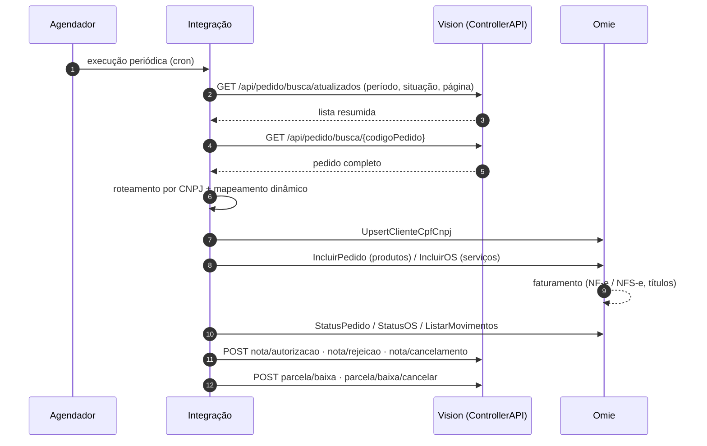
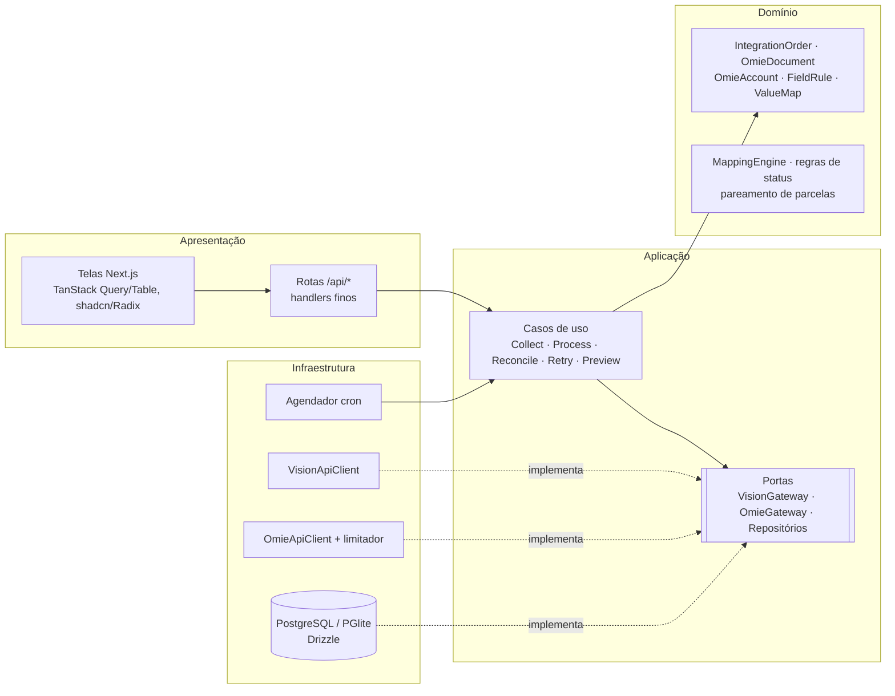

# Guia de implementação — Integração Vision ERP ⇄ Omie ERP

Projeto da JFHUB SOFTHOUSE para a **Ecolife Soluções Ambientais**. Este guia transforma o diagrama
[`integration-flow.png`](./integration-flow.png) e a proposta comercial em orientação de implementação,
e documenta como cada parte foi resolvida neste repositório.

> Referências técnicas: [ControllerAPI do Vision](./referencia-api-vision.md) · [API Omie](./referencia-api-omie.md)

---

## 1. Contexto e escopo

| Papel | Sistema | Responsabilidade |
|---|---|---|
| ERP operacional | **Vision** (ControllerAPI) | Origem dos pedidos de venda. Recebe de volta os eventos fiscais e financeiros. |
| Faturamento e financeiro | **Omie** (uma base por CNPJ) | Recebe cliente, pedido de venda e ordem de serviço; emite NF-e/NFS-e; gera e baixa títulos. |
| Middleware | **Esta aplicação** | Coleta, roteia, mapeia, envia, acompanha e devolve. Guarda estado, vínculos e logs. |

**Escopo estendido em relação ao diagrama:** além do Pedido de Venda (NF-e), a integração gera **Ordem de
Serviço** (NFS-e) no Omie quando o pedido do Vision tem `servicos`. Um pedido com produtos e serviços gera
os dois documentos, com as parcelas divididas proporcionalmente.

---

## 2. O fluxo extraído do diagrama



| # (diagrama) | Etapa | Chamada | Onde está no código |
|---|---|---|---|
| 1a | Execução periódica | cron (`*/5` coleta, `*/10` retorno) | `infrastructure/scheduler/integration-scheduler.ts`, `use-cases/jobs.ts` |
| 1–2 | Consulta incremental | `GET /api/pedido/busca/atualizados?dataInicial&dataFinal&codigoStatus&pagina&linhas` | `use-cases/collect-vision-orders.ts` |
| 3–4 | Pedido completo | `GET /api/pedido/busca/{codigoPedido}` | `use-cases/process-order.ts` (sempre busca de novo antes de enviar) |
| 5 | Sincronizar cliente | `geral/clientes › UpsertClienteCpfCnpj` | `application/customer-sync.ts` |
| 6 | Enviar pedido (CNPJ correto) | `produtos/pedido › IncluirPedido` · `servicos/os › IncluirOS` | `process-order.ts` + `omie-payload-builder.ts` |
| 7 | Omie processa | NF-e/NFS-e, títulos | (no Omie) |
| 8 | Retornos | `StatusPedido.ListaNfe` · `StatusOS.ListaRpsNfse` · `financas/mf › ListarMovimentos` | `use-cases/reconcile-order.ts`, `infrastructure/omie/omie-gateway.ts` |
| 9 | Autorização | `POST /api/pedido/nota/autorizacao` | `vision-return-builder.ts › authorization` |
| 10 | Rejeição | `POST /api/pedido/nota/rejeicao` | `vision-return-builder.ts › rejection` |
| 11 | Cancelamento | `POST /api/pedido/nota/cancelamento` | `vision-return-builder.ts › cancellation` |
| 12 | Baixa de parcela | `POST /api/pedido/parcela/baixa` | `vision-return-builder.ts › payment` |
| 13 | Cancelamento de baixa | `POST /api/pedido/parcela/baixa/cancelar` | `vision-return-builder.ts › paymentCancellation` |

### Regras importantes do diagrama → implementação

| Regra | Como foi implementada |
|---|---|
| Consulta incremental por `dataAtualizacao` | Checkpoint `vision.orders.updated` guarda a maior `dataAtualizacao` vista; a próxima janela começa nela menos a sobreposição (padrão 1 dia). Primeira execução: últimos 7 dias. |
| Paginação em lotes | Laço por `pagina` (50 por página, configurável) até o `TotalPaginas` informado pelo Vision (limite de segurança: 500 páginas). |
| Idempotência (empresa + pedido) | Um agregado por `codigoPedido` (índice único). No Omie, códigos de integração determinísticos (`VIS-14100`, `VIS-14100-OS`, `VIS-CLI-501`): antes de incluir, consulta pelo código; se a inclusão retornar "já cadastrado", vincula o existente. Testado com resposta perdida no meio da inclusão. |
| Dual CNPJ | `AccountRouter`. O pedido real do Vision traz só `CodigoEmpresa`, então a empresa é associada à conta Omie pela tabela "Empresa Vision → CNPJ". Se o Vision passar a mandar o CNPJ, ele tem prioridade. |
| Logs completos | Cada chamada externa vira um registro com request, response, HTTP e duração (segredos removidos, textos grandes truncados). |
| Reprocessamento | Novas tentativas automáticas com espera crescente para falhas temporárias; reenvio manual (individual, selecionados ou por causa). |
| Erros e alertas | Erro classificado (categoria, mensagem, dica, etapa, dados técnicos), visível no pedido, na lista e no painel. |

---

## 3. Arquitetura

Clean Architecture com DDD por contexto delimitado. As dependências apontam para dentro: o domínio não
conhece Next.js, banco nem HTTP.



```
src/
├─ app/                      Apresentação (páginas e rotas /api — viram controllers no NestJS)
├─ components/               UI (shadcn/Radix escritos no projeto, trilho do pedido)
└─ server/
   ├─ shared/                Kernel: Result, erros, Cnpj (inclui alfanumérico), datas, portas
   ├─ modules/
   │  ├─ omie-accounts/      Contas Omie (CNPJ, credenciais criptografadas, teste de conexão, listas)
   │  ├─ mappings/           Regras de campo, tabelas de-para, catálogo de campos, MappingEngine
   │  ├─ integration/        Agregado do pedido, documentos Omie, casos de uso, consultas (CQRS-lite)
   │  └─ settings/           Parâmetros operacionais
   ├─ infrastructure/        Vision, Omie, banco, agendador, HTTP
   └─ container.ts           Composition root (único lugar que conhece as implementações)
```

**SOLID na prática:** cada caso de uso tem uma responsabilidade; gateways e repositórios são interfaces
(substituídos por simuladores nos testes sem mudar uma linha da aplicação); o catálogo de campos e as
regras são dados, então campos novos não exigem código (aberto/fechado).

**Migração para NestJS:** `server/modules/*` e `server/infrastructure/*` são TypeScript puro. No NestJS,
`container.ts` vira os providers dos módulos e cada pasta `app/api/**/route.ts` vira um controller com o
mesmo contrato. O front só precisa de `NEXT_PUBLIC_API_BASE` apontando para o novo backend.

---

## 4. Modelo de domínio

**IntegrationOrder** (agregado raiz, 1 por pedido do Vision) contém 0–2 **OmieDocument** (PV e/ou OS).
O status do pedido é **derivado** das partes, nunca escrito à mão:

| Status | Quando |
|---|---|
| Na fila | Descoberto; algum documento ainda não foi enviado |
| Com erro | Existe erro registrado (envio ou retorno) |
| Aguardando faturamento | Todos os documentos estão no Omie; falta nota ou falta informar o Vision |
| NF rejeitada | Algum documento teve a nota rejeitada (motivo devolvido ao Vision) |
| Concluído | Notas autorizadas e autorização informada ao Vision |
| Cancelado | Documentos cancelados no Omie e cancelamento informado |
| Ignorado | Retirado da integração pelo usuário |

O **trilho** da interface mostra as estações Vision → Roteamento → Mapeamento → Omie → Faturamento →
Retorno; a estação vermelha é derivada da etapa do erro (`error.step`).

Cada evento devolvido ao Vision é marcado com uma assinatura (chave da NF, motivo da rejeição, id da baixa):
nada é retornado duas vezes, e uma baixa que some do Omie depois de informada vira "cancelamento de baixa".

---

## 5. Mapeamento dinâmico

Objetivo: nenhum campo Vision → Omie fixo no código. Tudo é configurável na tela **Mapeamentos**.

* **Regras de campo** — para cada campo do payload Omie (cliente, pedido de venda, OS) define a origem:
  * *Campo do Vision* — caminho (`cliente.cpfcnpj`) ou template (`{cliente.cidade} ({cliente.uf})`).
    Nos itens, caminhos são relativos ao item; `$pedido.` lê o cabeçalho.
  * *Valor fixo* — aceita `{{hoje}}` e `{{codigoPedido}}`. Quando o campo é um cadastro do Omie
    (categoria, conta corrente, departamento, projeto, vendedor, etapa, parcela, cenário), o valor é
    escolhido numa lista carregada **da base Omie da conta**.
  * *Tabela de-para* — traduz o código do Vision pelo de-para da conta (ex.: produto 123 → 4422421).
  * *Não enviar*.
  * Transformações encadeáveis (maiúsculas, só dígitos, data dd/mm/aaaa, número, S/N, DDD...) e valor
    padrão quando vazio.
* **Precedência:** regra da conta > regra de todas as contas > padrão do catálogo.
* **Campos personalizados:** qualquer caminho do payload Omie (ex.: `det[].inf_adic.peso_bruto`).
* **Tabelas de-para:** definidas uma vez (chave estável), preenchidas **por conta** (os códigos do Omie
  mudam por base). Importação colando da planilha. Tabelas de sistema: Produtos, Serviços,
  Empresa Vision → CNPJ, Conta corrente (retorno de baixas).
* **Campos do Vision disponíveis:** catálogo do Swagger + campos descobertos nos pedidos recebidos,
  sempre em camelCase (o adaptador converte o PascalCase da API: `Cliente.CPFCNPJ` → `cliente.cpfcnpj`).
* **Serviços:** o de-para padrão usa `codigoMaterial`, porque no Vision o `CodigoServico` das linhas
  de serviço chega 0.
* **Condição de pagamento** (`cabecalho.codigo_parcela` / `Cabecalho.cCodParc`): definida em
  *Configurações › Condições de pagamento*, nesta ordem:
  1. pedido com parcelas no Vision → 999 (parcelas informadas), com vencimentos e valores do Vision;
  2. sem parcelas → a condição associada à forma de pagamento do pedido (`codigoFormaPagamento`; a tela
     sugere as formas encontradas nos pedidos já lidos, ex.: `2 — SEM FINANCEIRO`);
  3. forma não configurada → a condição padrão para pedidos sem parcelas;
  4. nada configurado → o pedido para com a pendência "Condição de pagamento".

  A lista de condições é carregada do Omie. Uma regra em Mapeamentos para o campo substitui a
  configuração (por conta ou para todas), mas 999 continua exigindo parcelas. Pedido sem parcelas no
  Vision não tem retorno de baixas.
* **Checagens além do mapeamento** (no envio e na simulação): linha cujo `quantidade × valorUnitario`
  não fecha o `valorTotal` e condição de pagamento ausente ou 999 em pedido sem parcelas.
* **Simular mapeamento** (no pedido): mostra o payload final, a origem de cada campo e as pendências,
  sem chamar o Omie.

O motor (`MappingEngine`) é puro e testado: valida obrigatórios, tipos (inteiro, decimal, data, S/N),
trunca textos acima do limite do Omie com aviso, e devolve pendências com mensagem e dica para o usuário.
Todo o mapeamento é validado **antes** de qualquer chamada ao Omie.

---

## 6. Rastreabilidade de erros e reenvio

* Categorias: Roteamento por CNPJ, Mapeamento, Dados do pedido, Recusado pelo Omie, Credenciais do Omie,
  Limite de consumo do Omie, Omie indisponível, Recusado pelo Vision, Autenticação no Vision,
  Vision indisponível, Erro interno.
* Cada erro traz **mensagem**, **dica de correção**, **etapa**, **tentativas**, **próxima tentativa** e
  **dados técnicos** (resposta do Omie/Vision).
* Linha do tempo do pedido: todas as etapas e chamadas, com request/response. Reenvio e "ignorar"
  registram quem fez.
* Reenvio: no pedido, em lote (selecionados) ou "Reenviar todos" de uma causa no Painel.
* Retentativa automática só para falhas temporárias (padrão 2, 10, 30, 60, 180 min).

### Logs, auditoria e alertas

| O quê | Onde | Retenção padrão |
|---|---|---|
| Linha do tempo (etapas e chamadas às APIs) e webhooks recebidos | Pedido › Linha do tempo · Execuções | 90 dias (erros: 365) |
| Execuções das rotinas | Execuções | 365 dias |
| Auditoria: alterações de contas, regras, de-para e configurações; reenvios, ignorar, sincronizar agora, recomeçar a coleta | Auditoria | 730 dias |
| Logs do servidor (JSON por linha, com `requestId`) | saída padrão → Loki/CloudWatch/Datadog | do coletor |

* **Correlação:** toda resposta da API traz `x-request-id` (ou reaproveita o recebido). Erro inesperado
  devolve só esse código ao usuário; a mensagem técnica e a pilha vão para o log estruturado.
* **Autor:** vem do cabeçalho do proxy autenticado (`AUTH_USER_HEADER`, ou X-Forwarded-Email,
  X-Auth-Request-Email, Remote-User...). Sem proxy, aparece "Não identificado".
* **Retenção:** *Configurações › Retenção de logs*; limpeza diária às 03:17. O erro atual de cada pedido
  fica no próprio pedido, então a limpeza não esconde pendências.
* **Alertas no Slack** (*Configurações › Alertas no Slack*, webhook em `SLACK_WEBHOOK_URL`):
  * rotina com falha (Vision/Omie fora do ar, credencial recusada), no máximo um aviso igual por intervalo
    (padrão 60 min);
  * pedidos que entraram em erro: uma mensagem por execução, agrupada por causa, com link para cada
    pedido (`APP_BASE_URL`); novas tentativas do mesmo erro não repetem o aviso;
  * nota rejeitada, com o motivo.
* **Dados pessoais:** o ocultamento é por nome de campo (chaves, senhas, tokens). CPF/CNPJ, e-mail e
  endereço dos clientes ficam nos payloads da linha do tempo; ajuste a retenção conforme a política de
  LGPD da Ecolife.

---

## 7. Consumo da API Omie

Limites oficiais ("Limites de Consumo da API do Omie"): 240 req/min e 4 simultâneas por IP + App Key +
método; bloqueio de 30 min após 10 erros seguidos (HTTP 425); a mesma consulta repetida em menos de 60 s
é recusada; 100 registros por página. Aplicativos Trial/FIT têm limites menores.

A integração:
* limita leituras a 2 simultâneas por método e serializa inclusões por App Key;
* espaça os inícios de chamada (~200 req/min por método);
* guarda por 55 s a resposta de consultas idênticas (`OMIE_READ_CACHE_MS`);
* usa 100 registros por página nas listagens do Omie;
* faz até 2 novas tentativas imediatas para instabilidade e "Too many requests"; bloqueios viram nova
  tentativa agendada após o desbloqueio.

> Confirme com o Omie as condições comerciais vigentes do aplicativo de API de cada base. Um aplicativo
> bloqueado ou pausado aparece na integração como erro de *Credenciais do Omie*, com a resposta original
> do Omie nos dados técnicos.

---

## 8. Pontos a validar na homologação

As respostas reais do login, da lista e do pedido completo foram conferidas em 21/10/2026 (detalhes em
[referencia-api-vision.md](./referencia-api-vision.md#o-que-o-formato-real-mudou-na-integração)):
JSON em PascalCase, datas sem fuso, envelope com `TotalPaginas`, serviço identificado por
`CodigoMaterial`, pedido sem CNPJ da empresa e pedido "SEM FINANCEIRO" sem parcelas.

1. ✅ **Resposta do login** — JWT como string JSON, 120 min. O cliente renova pelo próprio token.
2. ✅ **Lista de atualizados** — envelope `{ Pagina, Linhas, TotalRegistros, TotalPaginas, Pedidos }`.
3. ✅ **CNPJ da empresa no pedido** — não vem. Em cada conta Omie, cadastre na tabela
   *Empresa Vision → CNPJ* o código da empresa do Vision que ela atende.
4. **Quantidade × valor unitário** — no pedido 14062 o total não fecha (271 × 5,18 = 1.403,78; total
   1.408,70). Pedir ao Vision as casas decimais reais de `Quantidade`. Enquanto isso, a integração
   bloqueia essas linhas (ou recalcula, conforme *Configurações › Roteamento e documentos*).
5. **Pedidos SEM FINANCEIRO** — vêm sem parcelas. Associe a forma de pagamento a uma condição do Omie em
   *Configurações › Condições de pagamento* (ou defina a condição padrão). Confirme se o Omie deve gerar
   título a receber para eles: a integração não devolve baixas de pedido sem parcelas no Vision.
6. **Convenções do retorno** — `codigoIntegracao` (enum `[1]`), `tipoNotaFiscal` (enum `[0,1]`), `tipo`,
   `especie`, `modelo` e `origemParcela` (enum `[0,1,2]`) estão em *Configurações › Convenções do
   retorno* e precisam da confirmação do suporte do Vision.
7. **Código da baixa no Vision** — o cancelamento de baixa usa o `codigoBaixa` devolvido pelo
   `POST parcela/baixa`; se o Vision não devolver, a integração envia o `nCodBaixa` do Omie.
8. **Situação da NF no Omie** — autorizada = `chave_nfe` com 44 dígitos e `protocolo`; rejeitada =
   mensagens sem chave. Confira com uma rejeição real de homologação.
9. **Baixas** — lidas de `financas/mf › ListarMovimentos` filtrando `nCodOS` (pedido de venda ou OS).
   Confirme baixas parciais e estornos.
10. **Situações elegíveis** — defina quais `codigoStatus` do Vision podem ser integrados. O exemplo real
    veio com `2 — CONCLUÍDO / FATURADO`: confirme se pedidos já faturados por outro caminho devem ficar de fora
    e a partir de que data a integração deve começar, para não reenviar o histórico.
11. **Categoria e conta corrente** são obrigatórias no Omie e não existem no pedido do Vision: configure
    antes de ligar a coleta (o Painel e a tela de regras avisam).

---

## 9. Plano de execução (alinhado à proposta)

| Fase | Entregas | Situação neste repositório |
|---|---|---|
| 1. Preparação | Credenciais, ambientes, validação dos endpoints, mapeamentos | Login e consultas do Vision validados com respostas reais; itens do §8 para validar |
| 2. Fundação | Projeto, persistência, configuração, logs, processamento | Concluída |
| 3. Vision → Omie | Coleta incremental, pedido completo, clientes, roteamento, PV e OS | Concluída |
| 4. Omie → Vision | Eventos fiscais, títulos, baixas, cancelamentos | Concluída |
| 5. Resiliência e testes | Idempotência, retries, testes, exceções | Concluída: 108 testes (≈90% das linhas do backend e das rotas), PostgreSQL real, 6 testes de tela e CI |
| 6. Homologação | Testes ponta a ponta reais, correções, documentação, implantação | Próximo passo |

### Checklist de homologação (critérios de aceite da proposta)

- [ ] Consulta incremental com os filtros e a paginação reais do Vision
- [ ] Pedido completo processado (cliente, itens, serviços, parcelas)
- [ ] Roteamento correto para as duas bases Omie
- [ ] Cliente criado/atualizado no Omie
- [ ] Pedido de venda e OS criados sem duplicidade (testar reenvio e queda de conexão)
- [ ] Autorização, rejeição e cancelamento devolvidos ao Vision
- [ ] Baixa e cancelamento de baixa devolvidos ao Vision
- [ ] Falhas registradas com causa clara e reenvio funcionando

---

## 10. Operação

* **Desenvolvimento:** `npm run simulators` + `.env.local` apontando para os simuladores + `npm run dev`
  + `npm run demo:seed`. Banco PGlite em `./.data` (sem instalar PostgreSQL).
* **Janela da primeira coleta:** 7 dias (`SYNC_INITIAL_LOOKBACK_DAYS`, editável em *Configurações ›
  Coleta*). Depois da primeira execução a coleta continua de onde parou; a mesma tela mostra até onde
  chegou e tem **Recomeçar a coleta**, que volta a buscar os últimos N dias sem duplicar pedidos.
* **Produção:** `DATABASE_URL` (PostgreSQL 14+), `APP_ENCRYPTION_KEY`, credenciais do Vision.
  `npm run build && npm start`. Migrações aplicadas automaticamente na inicialização.
* **Mais de uma instância:** a trava em banco (`job_locks`) impede rotinas simultâneas, e cada pedido é
  reservado durante o processamento. Alternativa: `SCHEDULER_ENABLED=false` e um cron externo chamando
  `POST /api/sync/run` (`{"job":"SYNC"}` ou `{"job":"RECONCILE"}`).
* **Webhook do Omie (opcional):** `OMIE_WEBHOOK_TOKEN` e cadastrar
  `https://<host>/api/webhooks/omie?token=...` no Developer Omie. O webhook só antecipa a consulta; a
  fonte de verdade continua sendo a API.
* **Alertas no Slack:** no Slack, crie um app com *Incoming Webhooks* para o canal da equipe, coloque a
  URL em `SLACK_WEBHOOK_URL` e o endereço da aplicação em `APP_BASE_URL`; ligue em *Configurações ›
  Alertas no Slack* e use **Enviar mensagem de teste**.
* **Segurança:** App Secret criptografado (AES-256-GCM), nunca devolvido pela API nem gravado em log.
  A interface ainda não tem login — publique atrás de um proxy autenticado (o usuário dele vai para a
  auditoria) até o backend NestJS com autenticação.
* **Qualidade:** `npm run test:coverage` (piso de cobertura), `TEST_DATABASE_URL=… npx vitest run tests`
  (PostgreSQL real) e `npm run build && npm run test:e2e` (telas). O GitHub Actions roda os três a cada
  push e pull request.
